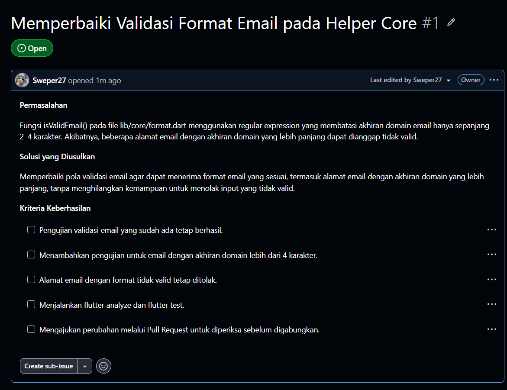
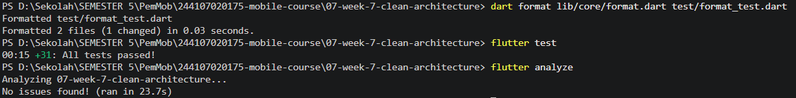
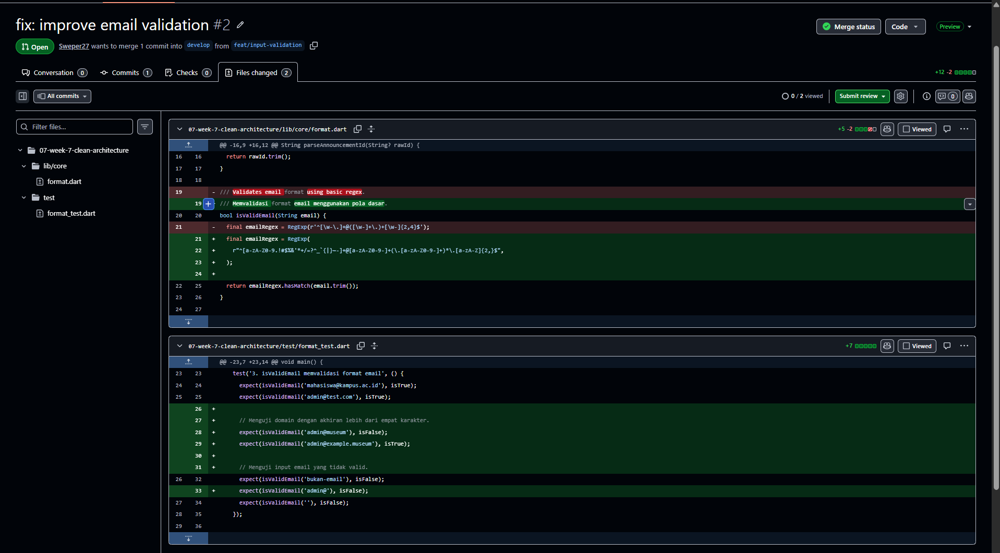
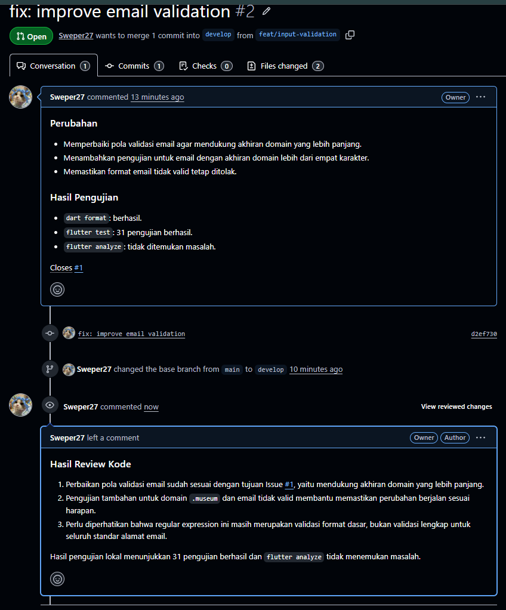

# Jobsheet 8 — Mid-Project Review dan Code Review

## 1. Identitas Mahasiswa

- **Nama:** [Rifqi Aries Saputra]
- **NIM:** [244107020175]
- **Kelas:** [TI-3H]

## 2. Tujuan Praktikum

Praktikum ini bertujuan untuk memahami proses peninjauan kode (*code review*) pada proyek Flutter yang menggunakan Clean Architecture, serta mempraktikkan pengelolaan perubahan kode menggunakan Git dan GitHub melalui Issue, branch, commit, dan Pull Request.

## 3. Deskripsi Perubahan

Perubahan dilakukan pada fungsi validasi email di file `lib/core/format.dart`.

Sebelumnya, pola regular expression membatasi akhiran domain email hanya sepanjang 2–4 karakter. Pembatasan tersebut dapat menyebabkan beberapa alamat email dengan akhiran domain yang lebih panjang dianggap tidak valid.

Perbaikan dilakukan dengan memperbarui pola validasi email dan menambahkan pengujian pada file `test/format_test.dart`.

### File yang Diubah

1. `lib/core/format.dart`
   - Memperbaiki pola regular expression pada fungsi `isValidEmail()`.
   - Mendukung akhiran domain yang lebih panjang.
2. `test/format_test.dart`
   - Menambahkan pengujian untuk domain `.museum`.
   - Menambahkan pengujian untuk alamat email yang tidak valid.

## 4. Tahapan Pengerjaan

1. Memeriksa struktur proyek Flutter dari Jobsheet 7.
2. Membuat GitHub Issue #1 untuk mencatat masalah validasi email.
3. Membuat branch `feat/input-validation`.
4. Memperbaiki fungsi `isValidEmail()` dan menambahkan unit test.
5. Menjalankan pemformatan kode menggunakan `dart format`.
6. Menjalankan pengujian menggunakan `flutter test`.
7. Memeriksa kode menggunakan `flutter analyze`.
8. Membuat commit dengan pesan `fix: improve email validation`.
9. Mengunggah branch ke GitHub dan membuat Pull Request #2.
10. Melakukan pemeriksaan perubahan kode melalui tab **Files changed** dan memberikan komentar review.
11. Menggabungkan Pull Request ke branch `develop` setelah proses review selesai.

## 5. Hasil Pengujian

### Pemformatan Kode

Perintah:

`dart format lib/core/format.dart test/format_test.dart`

Hasil: berhasil. Satu file mengalami perubahan format.

### Pengujian Unit

Perintah:

`flutter test`

Hasil: **31 pengujian berhasil**.

### Analisis Kode

Perintah:

`flutter analyze`

Hasil: **No issues found!**

## 6. Dokumentasi Screenshot

### Screenshot 1 — GitHub Issue

**File:** `screenshots/issue.png`

### Screenshot 2 — Hasil Pengujian

**File:** `screenshots/02-pengujian.png`

### Screenshot 3 — Perubahan Kode

**File:** `screenshots/perubahan-kode.png`

### Screenshot 4 — Code Review

**File:** `screenshots/code-review.png`

### Screenshot 5 — Pull Request Merged

**File:** `screenshots/05-pull-request-merged.png`

## 7. Refleksi
1. Apa beda LGTM buta dengan approve yang bertanggung jawab? Apa risikonya bagi tim?
LGTM (Looks Good To Me) secara buta berarti menyetujui perubahan tanpa benar-benar memeriksa kode, memahami dampaknya, atau menjalankan pengujian yang diperlukan. Sebaliknya, approve yang bertanggung jawab dilakukan setelah reviewer memahami tujuan perubahan, memeriksa diff, mempertimbangkan kasus tepi, dan melihat bukti dari test atau analyzer. LGTM buta berisiko meloloskan bug, menurunkan kualitas kode, menambah utang teknis, dan membuat anggota tim lain harus menghabiskan waktu untuk memperbaiki masalah yang sebenarnya bisa ditemukan saat review.
2. Kapan komentar wajib berstatus request changes, dan kapan cukup saran?
Request changes tepat digunakan ketika ditemukan masalah penting yang harus diperbaiki sebelum perubahan layak digabungkan, misalnya bug yang memengaruhi fungsi utama, risiko keamanan, pelanggaran aturan arsitektur yang nyata, atau test penting yang gagal. Komentar saran cukup digunakan untuk perbaikan yang tidak memblokir tujuan PR, seperti peningkatan cakupan kasus tepi, penyederhanaan implementasi, atau perbaikan yang dapat dilakukan pada pekerjaan berikutnya. Tingkat urgensi harus didasarkan pada dampak dan bukti, bukan sekadar preferensi pribadi.
3. Bagian mana dari review AI yang Anda tolak atau sederhanakan, dan mengapa?
Saya menolak atau tidak menerapkan rekomendasi untuk mengubah bagian arsitektur seperti Riverpod, GoRouter, SQLite, atau Dio apabila rekomendasi tersebut tidak didukung bukti dari diff. Perubahan PR hanya menyentuh helper validasi email dan unit test, sehingga perubahan arsitektur yang tidak relevan akan memperluas lingkup pekerjaan tanpa alasan teknis yang cukup. Saya juga memperlakukan temuan tentang format email yang lebih kompleks sebagai saran tindak lanjut sampai perilakunya dibuktikan melalui test, bukan langsung menganggapnya sebagai blocker.
4. Satu hal konkret yang Anda perbaiki setelah review sejawat — apa dampaknya?
Saya memperbarui regex validasi email agar dapat menerima domain dengan akhiran lebih dari empat karakter, misalnya admin@example.museum, dan menambahkan unit test untuk domain panjang, domain tanpa titik, serta input admin@. Dampaknya, perilaku validasi menjadi lebih sesuai dengan tujuan perubahan dan kasus-kasus tersebut memiliki pengujian regresi sehingga lebih mudah diperiksa kembali jika kode diubah pada masa mendatang.

## 8. Kesimpulan

Melalui praktikum ini, saya mempelajari proses pengelolaan perubahan kode menggunakan Git dan GitHub, mulai dari pencatatan masalah melalui Issue hingga pengajuan Pull Request untuk peninjauan kode. Perbaikan validasi email dilengkapi dengan unit test tambahan. Hasil pengujian menunjukkan 31 pengujian berhasil dan analisis kode tidak menemukan masalah. Praktikum ini membantu meningkatkan pemahaman mengenai pentingnya pengujian, dokumentasi, dan code review dalam pengembangan aplikasi Flutter secara kolaboratif.
