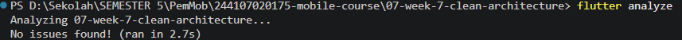
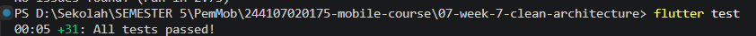
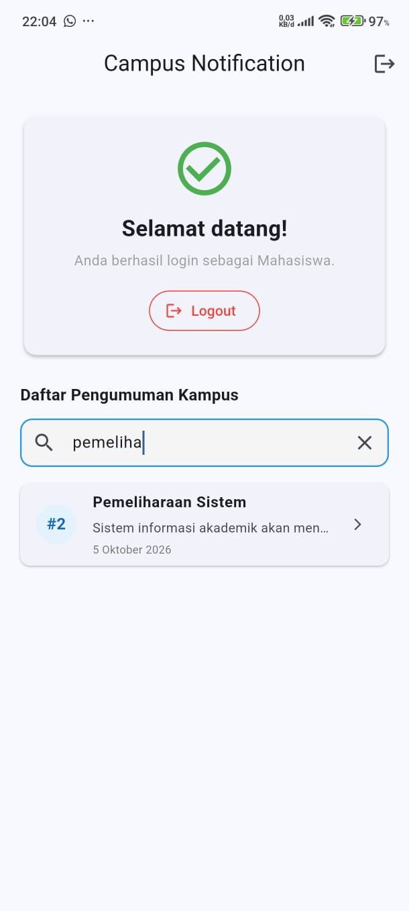
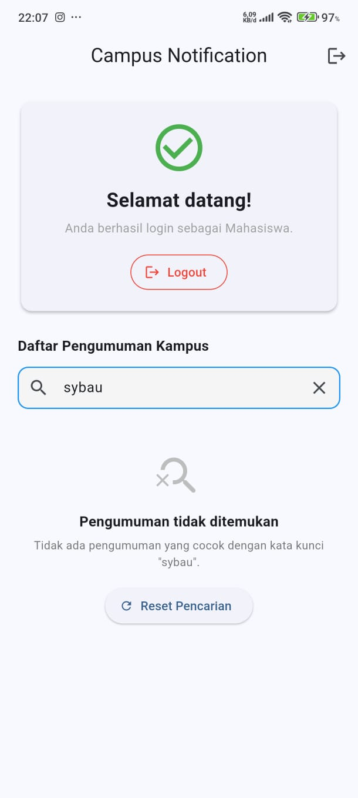

# Jobsheet 9 — AI-Assisted Development / Vibe Coding

## Identitas Mahasiswa
- **Nama:** Rifqi Aries Saputra
- **NIM:** 244107020175
- **Kelas:** TI-3H
- **Mata Kuliah:** Pemrograman Mobile
- **Jobsheet:** 9 (AI-Assisted Development / Vibe Coding)

---

## Deskripsi

Praktikum Jobsheet 9 ini berfokus pada penerapan paradigma **AI-Assisted Development** dan konsep **Vibe Coding** secara terukur, etis, dan bertanggung jawab. Mahasiswa bertindak sebagai arsitek utama dan pengarah teknis (*director/validator*), menggunakan bantuan kecerdasan buatan (*AI assistant*) untuk mempercepat penulisan fitur, kemudian memvalidasi, menguji, dan merefaktor keluaran AI agar tetap patuh terhadap standar arsitektur perangkat lunak modern (**Clean Architecture**), *null safety*, serta prinsip *Separation of Concerns* (SoC).

---

## Fitur yang Diimplementasikan

### Fitur: Pencarian Pengumuman Kampus & Informative Empty State
Pada halaman utama (`HomePage`), mahasiswa menambahkan fitur pencarian pengumuman secara *real-time* yang dilengkapi dengan *informative empty state*.

#### 1. Cara Penggunaan:
- Masuk ke aplikasi menuju `HomePage` (`Daftar Pengumuman Kampus`).
- Pada kolom pencarian bertuliskan *"Cari judul atau isi pengumuman..."*, ketik kata kunci yang ingin dicari (misalnya `"registrasi"`, `"pemeliharaan"`, atau `"mobile"`).
- Daftar pengumuman secara otomatis dan instan akan terfilter menyisakan pengumuman yang mengandung kata kunci tersebut pada judul atau isinya.
- Jika pengguna mengetik kata kunci yang tidak terdapat pada pengumuman mana pun (misalnya `"beasiswa luar negeri"`), aplikasi akan menampilkan **Informative Empty State** dengan ikon pencarian, pesan spesifik yang menyebutkan kata kunci pencarian, serta tombol **"Reset Pencarian"**.
- Menekan tombol **"Reset Pencarian"** atau ikon silang (**X**) pada kolom input akan membersihkan input teks dan mengembalikan seluruh daftar pengumuman kampus secara instan.

#### 2. Manfaat:
- Memudahkan mahasiswa menemukan pengumuman spesifik tanpa perlu menelusuri seluruh daftar satu per satu.
- Mencegah kebingungan pengguna melalui *empty state* yang informatif, menjelaskan mengapa daftar kosong, dan memberikan jalan keluar langsung (*recovery action*) dengan tombol reset.
- Menjaga performa aplikasi tetap cepat dan responsif tanpa *network/database overhead* karena filter dieksekusi secara sinkron pada *cached announcements*.

---

## Teknologi yang Digunakan

- **Flutter**: Version 3.47.1 (Channel stable)
- **Dart**: Version 3.13.1 (Sound Null Safety)
- **State Management**: `flutter_riverpod: ^2.6.1`
- **Routing**: `go_router: ^14.8.1`
- **Networking**: `dio: ^5.7.0`
- **Secure Storage**: `flutter_secure_storage: ^9.2.4`
- **Firebase & Notifikasi**: `firebase_core: ^3.12.1`, `firebase_messaging: ^15.2.4`, `flutter_local_notifications: ^18.0.1`
- **Linting & Testing**: `flutter_lints: ^6.0.0`, `flutter_test` (SDK)

---

## Workflow AI

Dalam menyelesaikan tugas Jobsheet 9, tahapan siklus kerja kolaborasi AI yang diterapkan adalah sebagai berikut:

```
+----------+      +------------+      +----------+      +--------+      +------------+      +-----------+
|  Prompt  | ---> |  Generate  | ---> |  Verify  | ---> |  Test  | ---> |  Refactor  | ---> |  Explain  |
+----------+      +------------+      +----------+      +--------+      +------------+      +-----------+
```

1. **Prompt**: Memberikan instruksi spesifik kepada AI mengenai tujuan fitur, batasan arsitektur (Clean Architecture *Feature-First*), dan *dependency* yang diizinkan (hanya menggunakan Riverpod dan Material Flutter tanpa package tambahan).
2. **Generate**: AI menghasilkan rancangan kode awal berupa komponen UI, Use Case, dan provider.
3. **Verify**: Memeriksa kode yang dihasilkan AI secara kritis terhadap potensi kesalahan API, pelanggaran layer Clean Architecture, *memory leak*, dan ketidaksesuaian versi package.
4. **Test**: Menjalankan analisis statis (`flutter analyze`) dan pengujian otomatis (`flutter test`) baik unit test maupun widget test untuk memvalidasi fungsionalitas dan *regression*.
5. **Refactor**: Memperbaiki kelemahan yang ditemukan dari hasil pengujian dan analisis statis, memindahkan *business logic* dari UI ke Domain layer, menangani *lifecycle controller* (`dispose`), serta memformat kode dengan `dart format`.
6. **Explain**: Mendokumentasikan rasionalisasi teknis atas setiap keputusan *Accept*, *Reject*, dan *Modified* ke dalam berkas `docs/ai-log.md`.

---

## Evaluasi Output AI

Berikut adalah ringkasan evaluasi output awal AI. Rincian teknis lengkap tersedia pada dokumen [`docs/ai-log.md`](docs/ai-log.md).

| Saran AI | Keputusan | Alasan Teknis | Bukti Verifikasi |
|---|---|---|---|
| Menambahkan method pencarian ke `AnnouncementRepository` | **Reject** | *Overengineering*. Data pengumuman lokal sudah dimuat di memori oleh provider. Menambah query repo menimbulkan latensi dan *boilerplate* yang tidak diperlukan. | `lib/features/announcements/data/repositories/announcement_repository_impl.dart` |
| Menempatkan logika filter `.where()` langsung di method `build()` | **Reject** | Melanggar *Separation of Concerns* pada Clean Architecture dan menyulitkan pembuatan unit test murni. | Prinsip Clean Architecture; modul Jobsheet 7 & 9 |
| Membuat Use Case murni `SearchAnnouncements` di Domain Layer | **Accept** | Logika bisnis murni terisolasi dari UI dan framework, dapat diuji secara independen menggunakan pure Dart unit test. | `lib/features/announcements/domain/usecases/search_announcements.dart` |
| Menggunakan `StateProvider<String>` & `filteredAnnouncementsProvider` | **Accept** | Sesuai standar Riverpod 2.6. Menggunakan `whenData` sehingga otomatis menangani status *loading* dan *error* tanpa redudansi kode. | `lib/features/announcements/presentation/providers/announcement_providers.dart` |
| Menggunakan `ConsumerWidget` murni dengan `TextEditingController` | **Modified** | `TextEditingController` tanpa pemanggilan `dispose()` menyebabkan potensi *memory leak*. Diubah menjadi `ConsumerStatefulWidget` dengan `dispose()`. | Siklus hidup Widget Flutter; static analyzer |
| Filter hanya mencocokkan `item.title.contains(query)` | **Modified** | Gagal jika pengguna mencari kata pada isi/body pengumuman atau menggunakan variasi huruf besar/kecil dan spasi. Diperbaiki: memeriksa `title` dan `body` dengan `.trim().toLowerCase()`. | `test/search_announcements_test.dart` |
| Tampilan kosong hanya teks statis `Text('Tidak ada pengumuman')` | **Modified** | UX kurang informatif. Ditingkatkan menjadi *Informative Empty State* dengan ikon, penjelasan kata kunci yang dicari, dan tombol "Reset Pencarian". | `lib/features/auth/presentation/pages/home_page.dart` |
| Widget test memanggil `tester.tap()` langsung pada tombol reset | **Modified** | Terjadi kegagalan karena posisi tombol berada di Y=651px (di luar viewport default 800x600). Diperbaiki dengan mengatur `tester.view.physicalSize` dan `await tester.ensureVisible()`. | `test/search_widget_test.dart` |

---

## Pengujian

Pengujian dijalankan dari direktori `09-week-9-ai-assisted-development`:

### 1. Format Kode (`dart format`)
```bash
dart format --output=none --set-exit-if-changed .
```
- **Hasil:** Seluruh 34 berkas Dart terformat rapi sesuai panduan resmi Dart.

### 2. Static Analysis (`flutter analyze`)
```bash
flutter analyze
```
- **Hasil:**
  ```text
  Analyzing 09-week-9-ai-assisted-development...
  No issues found! (ran in 2.4s)
  ```
  - Total error: **0**
  - Total warning: **0**
  - Total info/hint: **0**

### 3. Pengujian Otomatis (`flutter test`)
```bash
flutter test
```
- **Hasil:**
  ```text
  00:04 +43: All tests passed!
  ```
  - **Total Test Lulus:** 43 test (100% pass)
  - **Total Test Gagal:** 0 test
  - Rincian test yang dijalankan:
    - `test/announcement_usecase_test.dart`: 4 test (Domain Announcement UseCases)
    - `test/auth_usecase_test.dart`: 1 test (Domain Auth UseCase)
    - `test/auth_test.dart`: 18 test (TokenStore, AuthRepository, Notification Payload, Routes)
    - `test/format_test.dart`: 4 test (Formatting chip, ID parser, regex email validation, token masking)
    - `test/search_announcements_test.dart`: 11 test (8 UseCase scenarios + 3 Riverpod Provider scenarios)
    - `test/search_widget_test.dart`: 1 test (Interaksi UI pencarian, filter, informative empty state, dan reset button)

---

## Cara Menjalankan

1. Masuk ke direktori project Jobsheet 9:
   ```bash
   cd 09-week-9-ai-assisted-development
   ```

2. Ambil seluruh *dependencies* yang didefinisikan pada `pubspec.yaml`:
   ```bash
   flutter pub get
   ```

3. Jalankan pemeriksaan kode:
   ```bash
   flutter analyze
   flutter test
   ```

4. Jalankan aplikasi pada perangkat/emulator (misal Windows Desktop atau Android Emulator):
   ```bash
   flutter run -d windows
   # atau
   flutter run -d <device-id>
   ```

---

## Dokumentasi Screenshot

Berikut adalah daftar dokumentasi tangkapan layar fitur dan hasil pengujian:

| Keterangan | Gambar |
|---|---|
| **Hasil Static Analysis (`flutter analyze`)** |  |
| **Hasil Seluruh Pengujian Unit & Widget (`flutter test`)** |  |
| **Fitur Pencarian Pengumuman Berhasil Menyaring Data** |  *(Silakan simpan tangkapan layar fitur pencarian di sini)* |
| **Tampilan Informative Empty State & Tombol Reset** |  *(Silakan simpan tangkapan layar tampilan kosong di sini)* |

---

## Refleksi

### 1. Hallucination AI apa yang ditemukan dan bagaimana membuktikannya?
- **Temuan Nyata**: AI menyarankan pemanggilan fungsi `tester.tap(find.text('Reset Pencarian'))` langsung pada widget test tanpa memperhatikan *viewport* layar pengujian, mengasumsikan seluruh widget di dalam `SingleChildScrollView` pasti dapat di-*hit-test* secara default.
- **Cara Membuktikan**: Saat `flutter test test/search_widget_test.dart` dijalankan pertama kali, Flutter Test Framework melempar *warning* dan *exception*:
  `Offset (Offset(408.0, 651.0)) that would not hit test on the specified widget. Indeed, Offset(408.0, 651.0) is outside the bounds of the root of the render tree, Size(800.0, 600.0)`.
  Hal ini membuktikan asumsi AI keliru mengenai geometri rendering headless test di Flutter.

### 2. Prompt mana yang paling membantu dan perubahan apa yang dilakukan?
- **Prompt Paling Membantu**: Prompt ke-2: *"Pisahkan logika filtering pengumuman ke dalam Domain UseCase murni agar dapat diuji secara independen dengan unit test tanpa dependensi UI maupun Riverpod."*
- **Perubahan yang Dilakukan**: Prompt ini memaksa AI untuk tidak menempatkan logika bisnis di widget `HomePage` maupun memodifikasi layer Data secara tidak perlu. Hasilnya adalah kelas murni `SearchAnnouncements` di domain layer yang langsung siap diuji dengan Dart test standar tanpa memerlukan *mock* widget atau framework.

### 3. Refactoring apa yang dilakukan terhadap kode AI?
- **Refactoring Arsitektur**: Memindahkan pemfilteran dari widget method `build()` ke dalam Domain Use Case terpisah (`SearchAnnouncements`) dan presentation provider (`filteredAnnouncementsProvider`).
- **Refactoring Lifecycle**: Mengubah `HomePage` dari `ConsumerWidget` murni menjadi `ConsumerStatefulWidget` untuk menginisialisasi dan men-*dispose* `TextEditingController`, mencegah potensi kebocoran memori (*memory leak*).
- **Refactoring Logika String**: Menambahkan `.trim().toLowerCase()` pada `query`, `item.title`, dan `item.body` agar pencarian bersifat *case-insensitive* dan tahan terhadap spasi yang tidak disengaja.
- **Refactoring Pengujian**: Menambahkan penyesuaian ukuran layar pengujian (`tester.view.physicalSize`) dan pemanggilan `tester.ensureVisible()` pada tombol aksi *empty state*.

### 4. Keputusan accept/reject mana yang paling sulit dan mengapa?
- **Keputusan Paling Menantang**: Menolak (**Reject**) saran AI untuk menambahkan method pencarian `searchAnnouncements()` pada interface `AnnouncementRepository` dan `AnnouncementRepositoryImpl`.
- **Alasan**: Secara sekilas, menambahkan method pencarian ke repository terlihat "sangat Clean Architecture" dan sering dicontohkan di internet. Namun, pada konteks aplikasi ini, seluruh pengumuman telah diambil sekaligus di awal dan disimpan dalam state Riverpod. Jika pencarian didelegasikan kembali ke repository, aplikasi akan mengeksekusi *delay* asinkron tambahan yang tidak perlu setiap kali satu karakter diketik, memicu *loading spinner* terus-menerus, dan merusak kenyamanan pengguna (*user experience*). Keputusan yang tepat adalah menolak perubahan pada repository dan memilih membuat Domain Use Case penyaring *in-memory collection* yang sinkron dan bersih.
