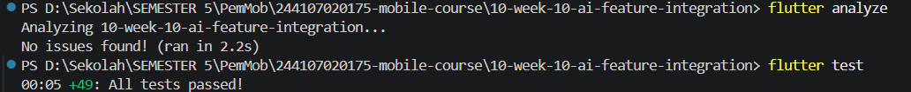
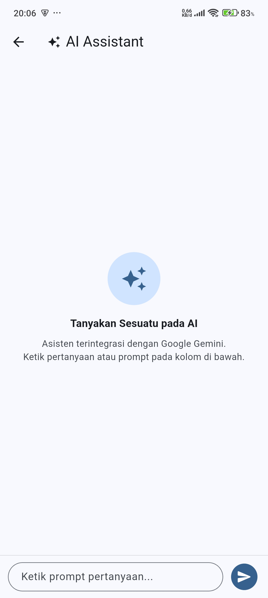
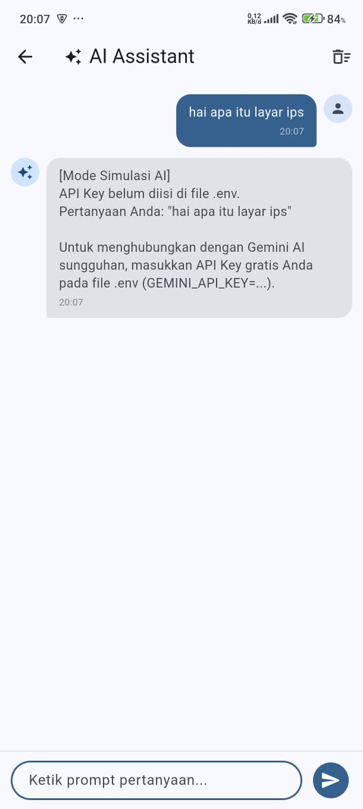

# Jobsheet 10 — Integrasi Fitur AI (AI Feature Integration)

## Identitas Mahasiswa
- **Nama:** Rifqi Aries Saputra
- **NIM:** 244107020175
- **Kelas:** TI-3H
- **Mata Kuliah:** Pemrograman Mobile

---

## Deskripsi Praktikum

Praktikum Jobsheet 10 berfokus pada **Integrasi Fitur Kecerdasan Buatan (AI Feature Integration)** ke dalam aplikasi mobile Flutter. Aplikasi `campus_notification` diperluas dengan menambahkan kapabilitas **Conversational AI / Smart Prompt Assistant** yang terhubung dengan Large Language Model (Google Gemini API via SDK `google_generative_ai`).

Integrasi ini dibangun secara profesional mengikuti standar industri:
1. **Keamanan Kredensial:** API Key disimpan secara terisolasi di file environment `.env` menggunakan pustaka `flutter_dotenv` dan diproteksi melalui `.gitignore` sejak awal agar tidak bocor ke version control.
2. **Clean Architecture & Separation of Concerns (SoC):** Pemisahan tegas antara layer *Data* (Remote DataSource & Model), *Domain* (Entity, Repository Contract, & UseCase), dan *Presentation* (UI & Riverpod StateNotifier).
3. **Robust State & Error Management:** Menangani seluruh siklus hidup interaksi AI: *Idle*, *Loading/Generating State*, *Success Response*, dan *Error Handling / Fallback Simulation* ketika API Key belum diisi atau terjadi gangguan koneksi.

---

## Fitur yang Diimplementasikan

### Fitur: AI Campus Assistant (Chat & Prompt Interface)
Halaman interaktif di mana mahasiswa dapat mengajukan pertanyaan, berdiskusi mengenai perkuliahan/pengumuman kampus, atau meminta ringkasan informasi langsung kepada AI Assistant.

#### 1. Cara Penggunaan:
1. Masuk ke aplikasi menuju `HomePage`.
2. Klik tombol mengambang **"Tanya AI"** (*FloatingActionButton*) di pojok kanan bawah atau ikon bintang berkilau (*auto_awesome*) pada AppBar.
3. Anda akan diarahkan ke halaman **AI Assistant** (`/ai-chat`).
4. Ketik prompt atau pertanyaan pada kolom pesan di bagian bawah, lalu tekan tombol kirim atau enter.
5. Pesan pengguna akan langsung muncul di daftar percakapan, dan indikator *loading* ("Sedang memproses...") akan aktif selagi model AI menyusun respon.
6. Jawaban AI akan ditampilkan secara rapi dalam gelembung percakapan (*chat bubble*).
7. Pengguna dapat membersihkan riwayat percakapan kapan saja melalui tombol *Sweep / Clear* di kanan atas AppBar.

#### 2. Graceful Fallback (Mode Simulasi):
- Jika pengguna belum mendaftarkan API Key di `.env`, aplikasi tidak akan *crash* atau *blank*.
- Sistem secara otomatis mendeteksi kondisi tersebut dan merespon dalam mode simulasi, mengarahkan pengguna untuk mendaftarkan API Key gratis dari [Google AI Studio](https://aistudio.google.com/app/apikey).

---

## Struktur Arsitektur (Clean Architecture)

```text
lib/
├── core/
│   ├── failures.dart                 # Failure domain hierarchy (ditambahkan AIFailure)
│   └── format.dart
├── features/
│   ├── ai/                           # Fitur Baru: AI Feature Integration
│   │   ├── data/
│   │   │   ├── datasources/
│   │   │   │   └── ai_remote_datasource.dart    # Komunikasi langsung dengan SDK GenerativeModel & .env
│   │   │   ├── models/
│   │   │   │   └── ai_message_model.dart        # Serialisasi & mapping data
│   │   │   └── repositories/
│   │   │       └── ai_repository_impl.dart      # Implementasi kontrak domain & mapping error
│   │   ├── domain/
│   │   │   ├── entities/
│   │   │   │   └── ai_message.dart              # Pure Dart entity (id, text, isUser, timestamp)
│   │   │   ├── repositories/
│   │   │   │   └── ai_repository.dart           # Interface abstrak repository
│   │   │   └── usecases/
│   │   │       └── send_prompt_usecase.dart     # Business logic & validasi prompt
│   │   └── presentation/
│   │       ├── pages/
│   │       │   └── ai_chat_page.dart            # Halaman UI Chat interaktif
│   │       ├── providers/
│   │       │   └── ai_providers.dart            # StateNotifier & Provider Riverpod
│   │       └── widgets/
│   │           └── chat_bubble.dart             # Widget tampilan bubble chat modern
│   ├── announcements/                # Fitur pengumuman kampus
│   └── auth/                         # Fitur autentikasi mahasiswa
├── routes.dart                       # Konfigurasi rute GoRouter (penambahan /ai-chat)
└── main.dart                         # Entry point aplikasi & inisialisasi dotenv.load()
```

---

## Keamanan API Key & Konfigurasi .env

1. **Aturan `.gitignore`:**
   ```gitignore
   # Environment variables and secrets
   .env
   .env.*
   !.env.example
   ```
2. **Template `.env.example`:**
   ```env
   # Google Gemini API Key
   # Dapatkan API Key di: https://aistudio.google.com/app/apikey
   GEMINI_API_KEY=YOUR_GEMINI_API_KEY_HERE
   ```
3. **Mengisi API Key Asli:**
   - Salin `.env.example` menjadi `.env`.
   - Masukkan API Key Anda pada variabel `GEMINI_API_KEY`.
   - File `.env` secara otomatis diabaikan oleh Git sehingga aman dari kebocoran ke repositori publik.

---

## Hasil Pengujian & dokumentasi

1. **Analisis Linter (`flutter analyze`):**
| **Hasil Static Analysis (`flutter analyze`)** |  |

2. **halaman ai assistant**
| **Hasil ai assistant (`flutter analyze`)** |  |

3. **pengetesan chat ai**
| **Hasil ai assistant (`flutter analyze`)** |  |
## Refleksi 

1. **Fitur AI mana yang Anda integrasikan dan mengapa?**

Jawaban: Fitur AI yang diintegrasikan adalah pemrosesan teks berbasis LLM menggunakan SDK Google Generative AI (gemini-1.5-flash) untuk membuat conversational chat assistant. Model versi flash dipilih karena memiliki kecepatan respon (latency) yang sangat tinggi, konsumsi daya/sumber daya yang efisien untuk perangkat mobile, serta biaya operasional API yang jauh lebih ekonomis dibanding model yang lebih besar.

2. **Bagaimana Anda melindungi privasi pengguna saat menggunakan AI API?**

Jawaban: Perlindungan privasi dilakukan melalui dua sisi:

Keamanan Kredensial: Mengamankan GEMINI_API_KEY menggunakan file .env dan mendaftarkannya ke .gitignore agar kunci API tidak terekspos ke publik/repositori Git.

Minimalisasi Data: Hanya mengirimi prompt/pertanyaan teks yang dimasukkan oleh pengguna secara eksplisit ke endpoint Gemini API tanpa menyertakan data sensitif pengguna (seperti identitas perangkat, lokasi, atau informasi pribadi).

3. **Fallback apa yang Anda sediakan jika layanan AI error?**

Jawaban: Aplikasi menerapkan mekanisme penanganan kesalahan (error handling) bertingkat menggunakan blok try-catch:

Menampilkan pesan kesalahan (error message) yang informatif dan ramah pengguna via UI (seperti SnackBar atau tampilan error state) daripada membiarkan aplikasi crash.

Menyediakan tombol Coba Lagi (Retry) untuk memicu pemanggilan ulang API ketika terjadi masalah koneksi internet atau rate limit.

Memastikan state loading langsung dimatikan kembali saat error terjadi agar input teks pengguna tidak terkunci.

4. **Satu hal yang Anda pelajari tentang UX fitur AI di mobile?**

Jawaban: Hal paling berharga yang dipelajari adalah pentingnya memberikan umpan balik visual (visual feedback) seketika karena respon AI membutuhkan waktu beberapa detik (latency). Menggunakan indikator loading (atau streaming response) dan menonaktifkan tombol kirim saat proses berlangsung sangat penting agar pengguna tahu aplikasi sedang bekerja dan mencegah pengguna menekan tombol berulang kali (double submission).